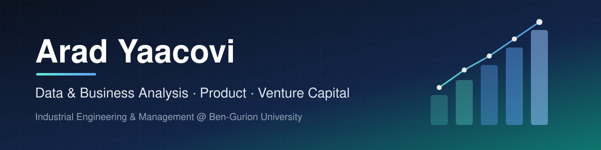

 

## 👋 About

Third-year **Industrial Engineering & Management** student at **Ben-Gurion University**, in the Atidim excellence program for industry and high-tech. I work at the intersection of **data, technology and business**: turning messy processes into clear systems, and clear systems into decisions.

Outside class I'm part of **Cactus Capital**, BGU's student-run VC fund, where I mentor early-stage university startups and guide them toward the investment committee. Before that: digital marketing (campaign management, content strategy) and a leadership role at the National Union of Israeli Students.

I design and direct the projects below and build them with AI coding tools (Claude Code, Cursor). Each repo's README states what I did and what the tools did.

**🔎 Looking for:** student roles in data and business analysis, product / product analytics, strategy & BizOps, and data operations. Israel.

## 🚀 Featured Projects

| | Project | What it shows |
|---|---|---|
| 🎓 | [**student-copilot**](https://github.com/aradyaacovi/student-copilot) · [live demo](https://aradyaacovi.github.io/student-copilot/?demo=1) | Product thinking end to end: a semester command center with a deadline-prioritization engine, n8n automations, Supabase (row-level security) and an installable PWA. Hebrew/RTL first. |
| 📈 | [**vc-deal-pipeline**](https://github.com/aradyaacovi/vc-deal-pipeline) | A deal-flow tracker for a small VC team: pipeline board, weighted traffic-light evaluations, roles, stale-deal detection, CSV import. Fictional data, unit-tested logic. |
| 🗄️ | [**ecommerce-sql-database**](https://github.com/aradyaacovi/ecommerce-sql-database) | SQL Server design and analysis: 10-table schema, CTEs and window functions, trigger, stored procedure, synthetic data in Python, Power BI report. Team project. |
| ⚙️ | [**production-scheduling-optimization**](https://github.com/aradyaacovi/production-scheduling-optimization) | Operations research: a genetic algorithm orders the jobs, a linear program sets exact timing, for just-in-time single-machine scheduling. Two-person project. |

## 🧰 Skills

| Area | Tools & methods |
|---|---|
| **Data** | SQL (strongest) · Excel · Power BI *(learning)* |
| **Programming** | Python · JavaScript · Git |
| **Business & product** | Requirements and process analysis · prioritization · VC deal evaluation |
| **Optimization** | Genetic algorithms · linear programming |
| **Building with AI** | Claude Code · Cursor — scoping, directing and reviewing the work |

## 📫 Contact

---
## Hi, I'm Arad

Third-year Industrial Engineering & Management student at Ben-Gurion University (BGU). I work where data, technology and business meet: analytics, product, strategy and venture capital.

I design and direct the projects below and build them with AI coding tools (Claude Code, Cursor). Each README says what I did and what the tools did.

### Projects

- **[student-copilot](https://github.com/aradyaacovi/student-copilot)** ([live demo](https://aradyaacovi.github.io/student-copilot/?demo=1)) – A semester command center that answers "what should I work on right now?". A prioritization engine ranks deadlines by effort and slack; n8n automations sync Moodle and read schedule-change emails; Supabase with row-level security; installable PWA. Hebrew (RTL) first.
- **[vc-deal-pipeline](https://github.com/aradyaacovi/vc-deal-pipeline)** ([live demo](https://aradyaacovi.github.io/vc-deal-pipeline/)) – A deal-flow tracker for a small VC team: pipeline board, weighted traffic-light evaluation, analyst and manager roles, stale-deal detection, CSV import. Fictional data, unit-tested logic, no dependencies.
- **[ecommerce-sql-database](https://github.com/aradyaacovi/ecommerce-sql-database)** – SQL Server database for a jewelry e-commerce case study: 10-table schema, analytical queries (CTEs, window functions), a trigger and a stored procedure, synthetic data generated in Python, and a Power BI report. Team project.
- **[production-scheduling-optimization](https://github.com/aradyaacovi/production-scheduling-optimization)** – Single-machine just-in-time scheduling: a genetic algorithm searches the job order and a linear program times each order exactly. Two-person project.

### Also

- Atidim excellence program for industry & high-tech
- Cactus Capital, BGU's student-run VC fund: mentoring early-stage university startups toward the investment committee
- Background in digital marketing (campaign management, content strategy)

**Tools:** SQL (strongest), Python, Excel, Power BI (learning), JavaScript, Git

[LinkedIn](https://www.linkedin.com/in/arad-yaacovi)
